<p align="center">
  
</p>

<h1 align="center">OpenShelf</h1>

<p align="center">
  <b>Turn your PC into a content server for your team.</b><br>
  Photos, videos, music, PDFs and notes, shared fast over your own Wi-Fi, with you in charge.
</p>

<p align="center">
  <a href="https://github.com/sidvashisth2005/OpenShelf/releases/latest"></a>
  <a href="https://github.com/sidvashisth2005/OpenShelf/actions/workflows/ci.yml"></a>
  <a href="LICENSE"></a>
  
</p>

<p align="center">
  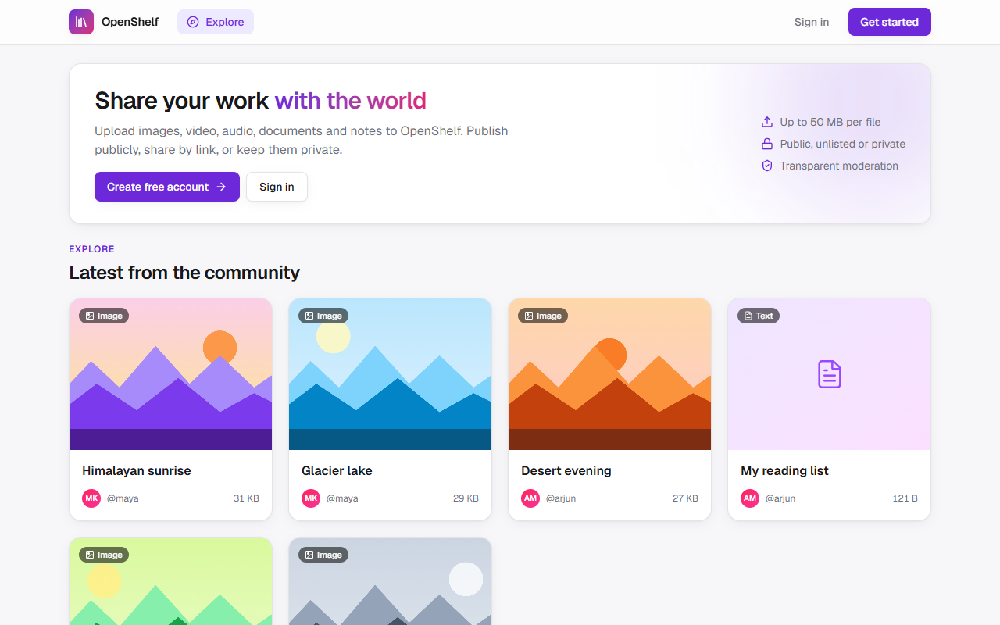
</p>

## How it works

- **One person installs OpenShelf.** Their PC becomes the server, and they become its **admin**.
- **Teammates join with an invite link.** On the same Wi-Fi, files move directly between their devices and the
  server, so it's fast and nothing goes through the internet.
- **Everyone keeps their own shelf.** Members upload and share. The admin manages members, invites and content.

---

## Install in 1 minute (Windows)

> **Full step-by-step guide for admins, members and the platform owner: [INSTALL.md](INSTALL.md).**

**Step 1.** Open **PowerShell**: press the <kbd>Windows</kbd> key, type `PowerShell`, and press <kbd>Enter</kbd>.

**Step 2.** Copy this line, paste it into PowerShell (right-click pastes), and press <kbd>Enter</kbd>:

```powershell
irm https://raw.githubusercontent.com/sidvashisth2005/OpenShelf/main/install.ps1 | iex
```

Press <kbd>Enter</kbd> when it asks `Continue? [Y/n]`. It installs, tests itself, and **opens in your browser**.

**Step 3.** In the browser, **create your admin account**: pick a server name, your name, email and password.
That's it, you're the admin.

<p align="center">
  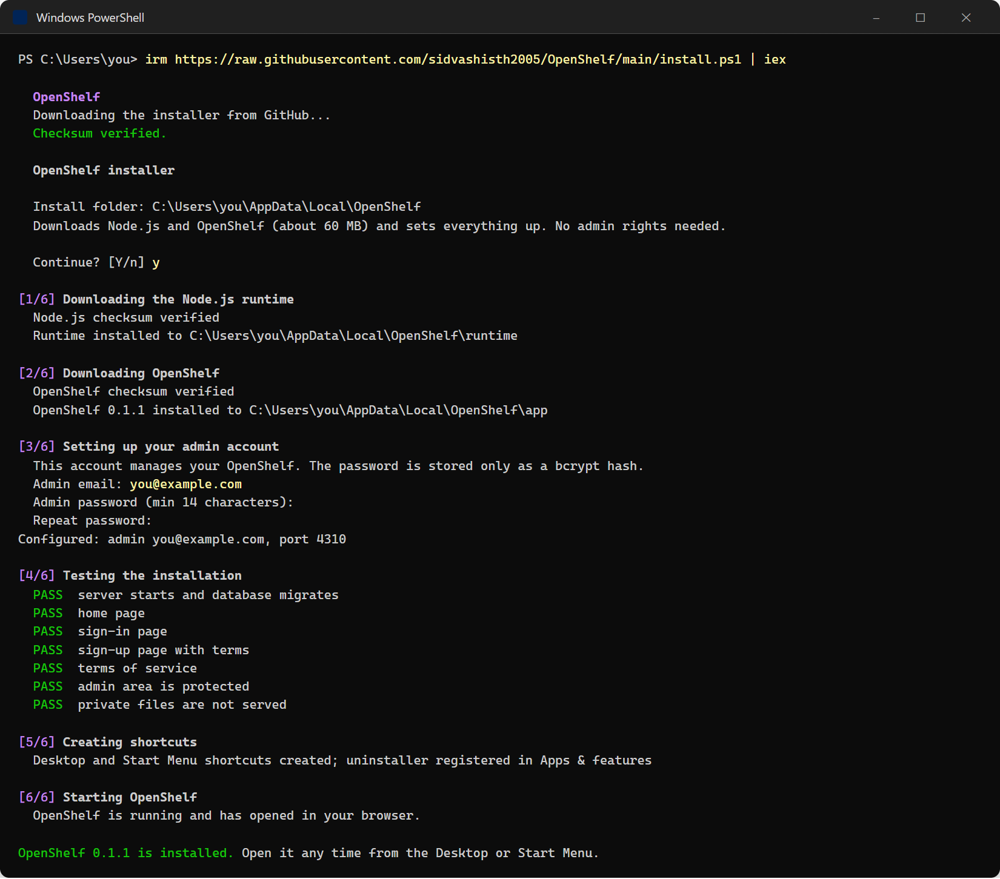
</p>

Next time, open OpenShelf from the **OpenShelf** icon on your Desktop or in the Start Menu.

> **Why PowerShell and not a download button?** The command downloads the official installer from this
> repository, checks that it hasn't been changed (SHA-256), and runs it. You skip the browser's "isn't
> commonly downloaded" and SmartScreen warnings that unsigned new apps get.

<details>
<summary><b>Prefer downloading the .exe?</b></summary>

1. Download **[OpenShelf.exe](https://github.com/sidvashisth2005/OpenShelf/releases/latest/download/OpenShelf.exe)**.
2. If your browser says *"OpenShelf.exe isn't commonly downloaded"*: open the downloads list, choose **…** →
   **Keep** → **Show more** → **Keep anyway**.
3. Double-click it. If Windows shows *"Windows protected your PC"*, click **More info** → **Run anyway**.

These warnings appear because the installer isn't code-signed yet. See
[RELEASING.md](RELEASING.md#code-signing-removes-the-smartscreen-warning).
</details>

<details>
<summary><b>macOS / Linux, or developers</b></summary>

You need [Node.js 20.9 or newer](https://nodejs.org).

```bash
git clone https://github.com/sidvashisth2005/OpenShelf.git
cd OpenShelf
./setup.sh          # Windows: setup.cmd
npm start           # then open http://localhost:3000 and create your admin account
```

See the [developer guide](docs/DEVELOPMENT.md).
</details>

**What you need:** Windows 10 or 11, internet during install (about 60 MB), and about 300 MB of disk space. You don't
need admin rights.

---

## Bring your team in (same Wi-Fi)

| | |
| --- | --- |
| 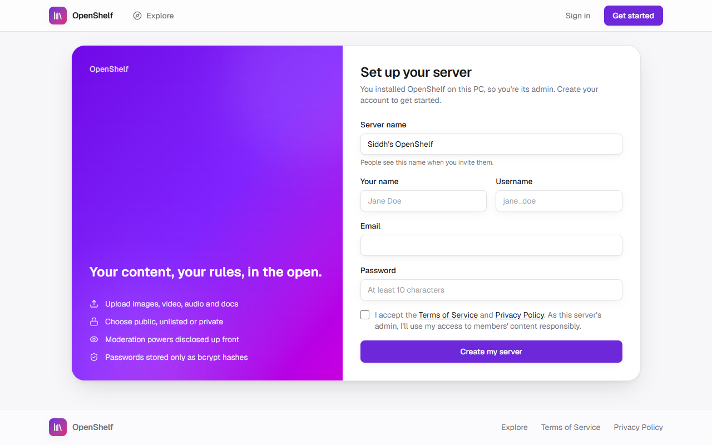 | **1. Set up your server.** The first time OpenShelf opens, you create the admin account. This page only opens on the PC where OpenShelf is installed, so nobody else can claim your server. |
| 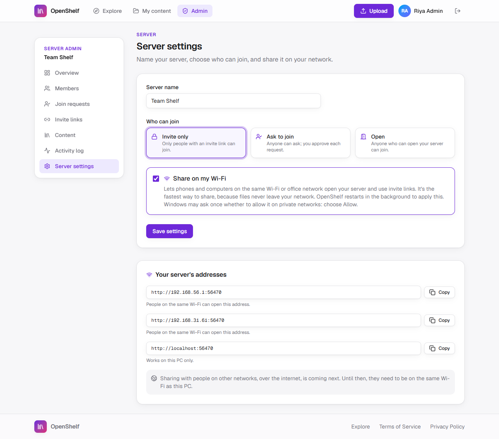 | **2. Turn on "Share on my Wi-Fi".** In **Admin → Server settings**. OpenShelf restarts itself in the background. If Windows asks whether to allow it on private networks, choose **Allow**. You also choose who can join: **Invite only**, **Ask to join** (you approve each person) or **Open**. |
| 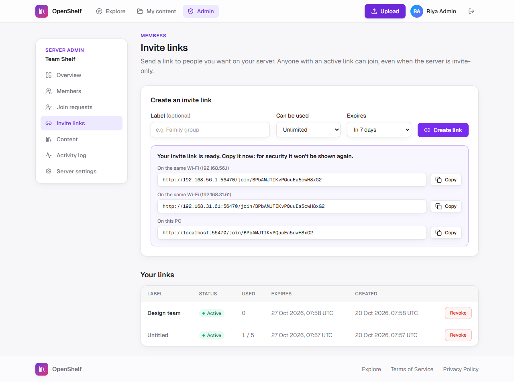 | **3. Create an invite link.** In **Admin → Invite links**: choose how many people can use it and when it expires, then click **Create link**, copy the **On the same Wi-Fi** link (it's shown only once) and send it to your team. |
| 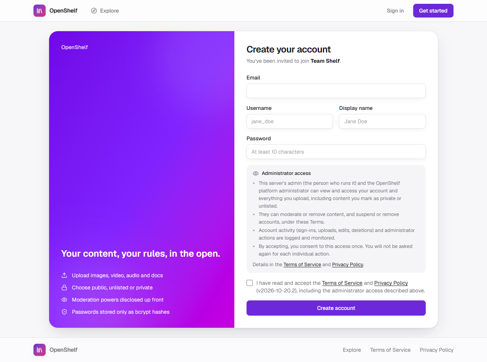 | **4. Teammates open the link** on any phone or laptop on the same Wi-Fi, create their account, and they're in. At sign-up they see, and agree once to, what the admin can access. |
| 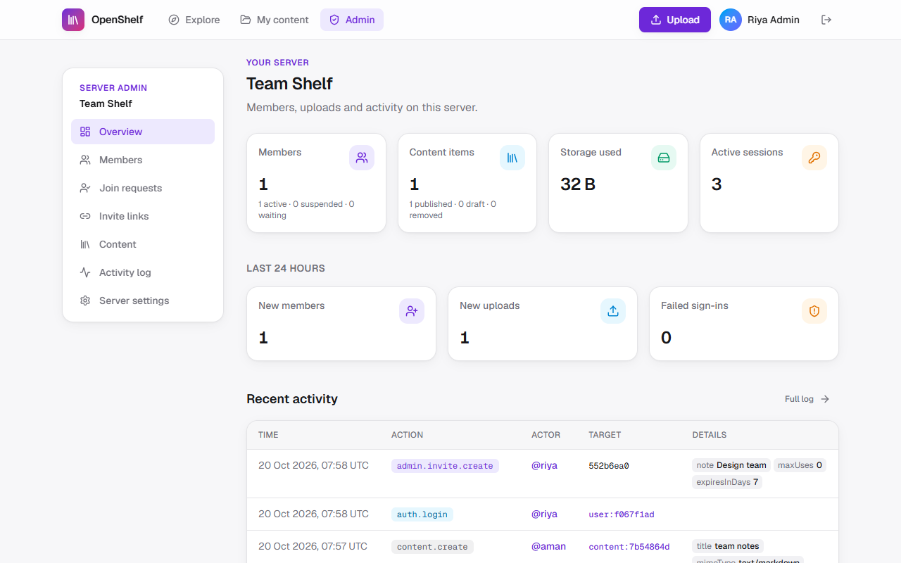 | **5. Manage everything** from the admin dashboard: members, join requests, invite links, content moderation and the activity log. |

### Joining as a member (nothing to install)

1. Open the invite link on any phone or laptop on the **same Wi-Fi** as the server.
2. Pick a username, enter your email and a password.
3. Tick the box to accept the Terms (you're asked **once**, never again) and click **Create account**.

Done. Use **Upload** to add files, and find them under **My content**.

---

## What members can do

| | |
| --- | --- |
| 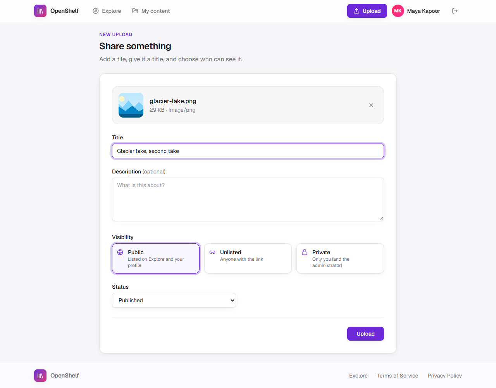 | **Upload anything.** Drag and drop images, videos, music, PDFs and notes (up to 50 MB each), and choose who can see each one: **Public**, **Unlisted** (link only) or **Private**. |
| 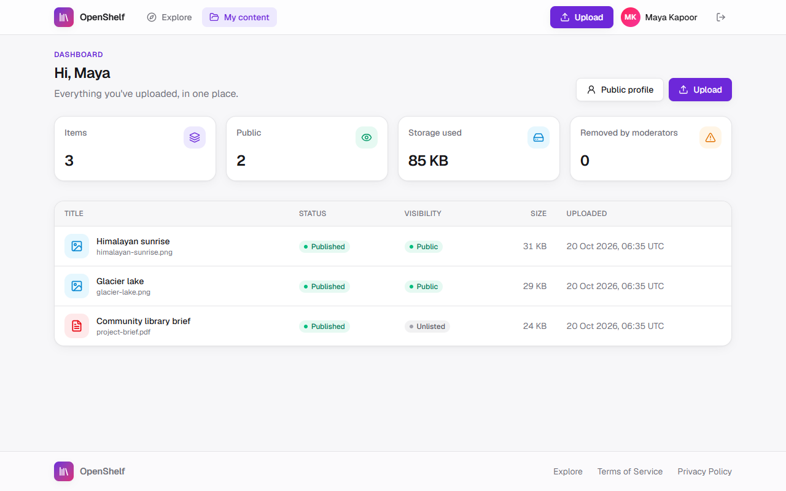 | **Manage their shelf.** See everything they uploaded, edit details, or delete items at any time. |
| 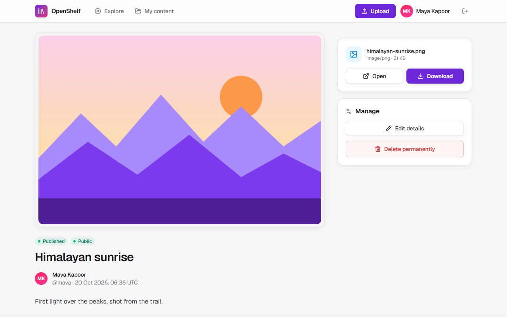 | **Share a page for every item,** with previews and Open/Download buttons. |

<p align="center">
  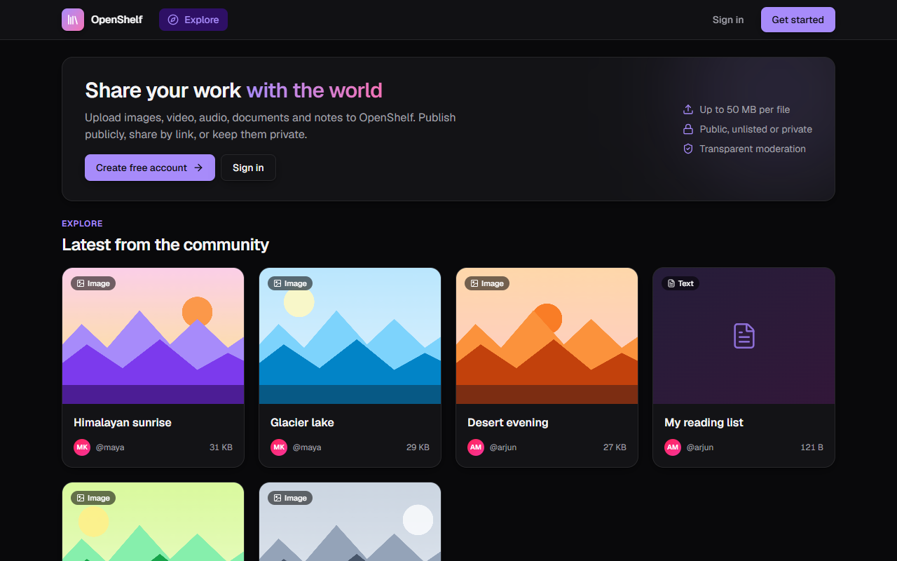
  &nbsp;
  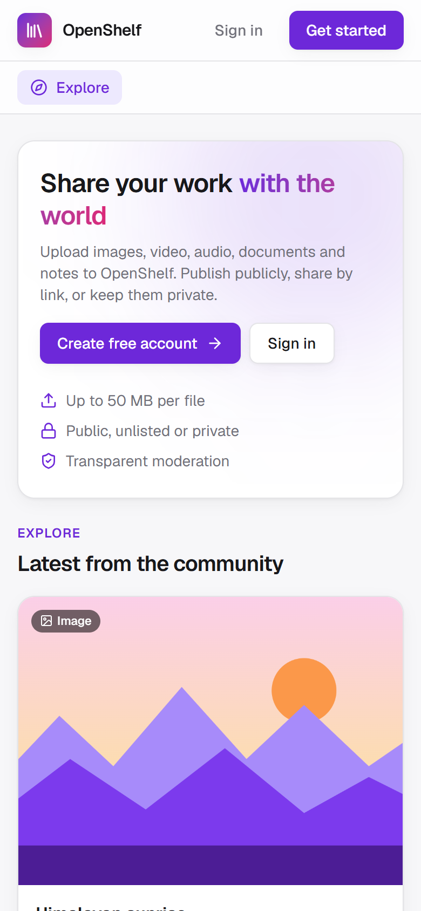
  <br><sub>Dark mode follows your system setting, and it works on phones too.</sub>
</p>

## Roles

| Role | Who | Can do |
| --- | --- | --- |
| **Member** | People who join a server | Upload, share and manage their own content |
| **Admin** | Whoever installed OpenShelf on their PC | Everything on their server: members, invites, join requests, settings, moderation, activity log. Members consent to this access once, at sign-up. |
| **Super Admin** | The OpenShelf platform owner | Everything an admin can do, on every server. Disclosed in the [Terms](src/lib/legal.ts). |

## Super Admin panel (platform owner only)

Servers that are online report to a free Super Admin panel (Cloudflare Workers + D1). From the panel, the platform
owner sees every server, its members and content, and can open any server as Super Admin through a private, gated
link. Admins and members never need to do anything for this.

**One-time setup** (needs a free [Cloudflare account](https://dash.cloudflare.com/sign-up), Node.js and Git):

```powershell
git clone https://github.com/sidvashisth2005/OpenShelf.git
cd OpenShelf
npm install
cd panel; npx wrangler login; cd ..     # click "Allow" in the browser
npm run panel:setup                     # prints the panel address and your panel key (shown once: save it)
```

Then commit the `installer/panel.json` it writes and publish a release ([RELEASING.md](RELEASING.md)). Every server
on that release links to your panel automatically. Open the panel address, sign in with your panel key, and click
**Open live server** on any online server. Lost the key? Run `npm run panel:new-key` (no release
needed).

> **Coming next:** members on other networks will be able to join over the internet. Teams on the same Wi-Fi keep
> transferring locally at full speed.

## Updating and uninstalling

- **Updates:** for big new versions, OpenShelf shows a popup the next time you open it. Click **Yes**; your data
  is kept. To update manually, run the install command again.
- **Uninstall:** **Settings → Apps → Installed apps → OpenShelf → Uninstall.** It asks whether to keep your data.
- **Your data** (database, uploads, settings) lives in `%LOCALAPPDATA%\OpenShelf\data`.

## FAQ

<details>
<summary>Is it safe to run a command from the internet?</summary>

The command only downloads [`install.ps1`](install.ps1) from this repository, so you can read exactly what it
does. It downloads `OpenShelf.exe` from this repository's releases, verifies its SHA-256 checksum, and refuses to
run it if the checksum doesn't match. The installer verifies Node.js and the app the same way.
</details>

<details>
<summary>Teammates can't open the Wi-Fi link.</summary>

- Make sure **Share on my Wi-Fi** is on (Admin → Server settings) and that you are all on the same network.
- If Windows asked whether to allow OpenShelf (Node.js) on the network, it needs **Allow** for *private*
  networks. Your Wi-Fi must be set to *Private* in Windows network settings.
- Some public, hotel or office networks block devices from reaching each other. Use a home or team network.
</details>

<details>
<summary>I forgot my password.</summary>

Open PowerShell and run:

```powershell
cd $env:LOCALAPPDATA\OpenShelf\app
..\runtime\node.exe openshelf.mjs reset-password --email you@example.com
```

Type the new password twice (it stays hidden), then open OpenShelf again from the Desktop icon.
</details>

---

## For developers

- [Installation guide](INSTALL.md): admins, members, and the Super Admin panel.
- [Developer guide](docs/DEVELOPMENT.md): stack, configuration, architecture, roles, database, Docker and scripts.
- [Security](SECURITY.md): the full security checklist, and how to report a vulnerability.
- [Releasing](RELEASING.md): how releases, update popups and code signing work.

OpenShelf is open source under the [MIT license](LICENSE).
